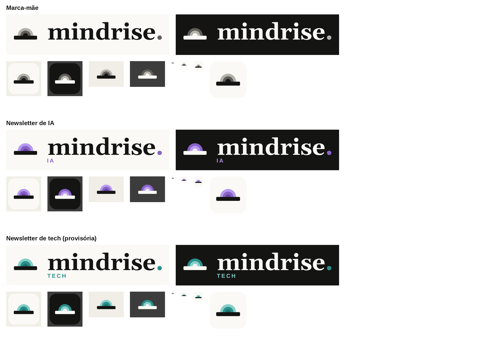
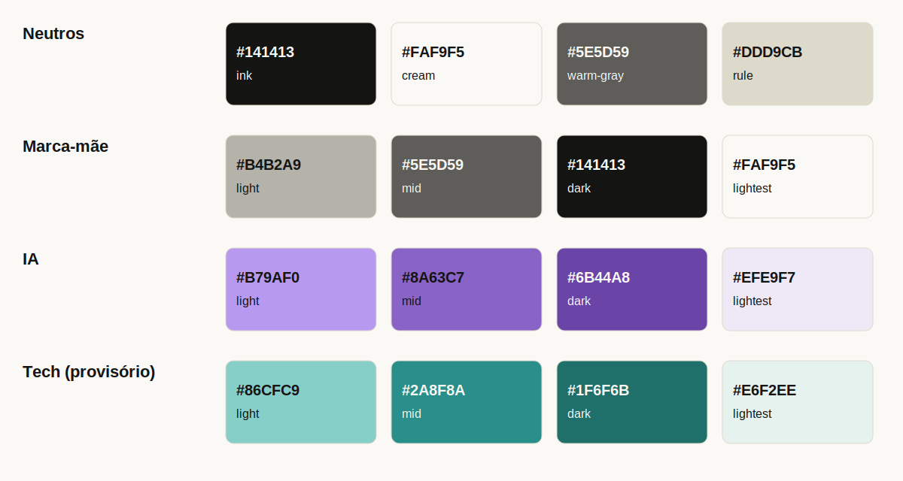
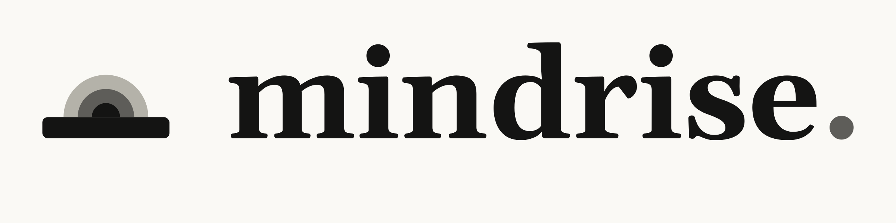
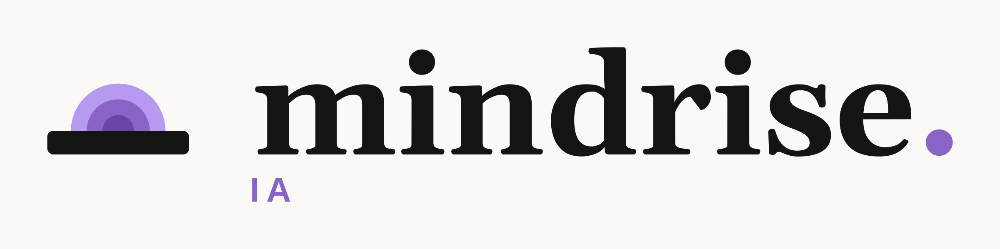

# mindrise-brand

Fonte única da identidade visual da **mindrise.** e de suas newsletters: tokens, scripts e assets.



## Paleta



A newsletter de tech é provisória. Valores em `tokens/tokens.json`.

## Logos

**Marca-mãe**



**Newsletter de IA**



## Estrutura

| Pasta | Conteúdo |
| --- | --- |
| `tokens/` | `tokens.json` no padrão W3C DTCG 2025.10: cores, geometria, tipografia |
| `scripts/` | `gen_logo.py` (assets), `gen_showcase.py` (docs), `contrast.py` (WCAG) |
| `assets/01-nucleo/` | marca-mãe |
| `assets/02-newsletters/ia/` e `tech/` | uma pasta por newsletter |
| `assets/03-aplicacoes/` | e-mail, web e redes sociais (Parte 4) |
| `assets/04-templates/` | modelos de banner, capa e carrossel (Parte 4) |
| `assets/manifest.json` | lista de todos os arquivos com seus metadados |
| `fonts/` | Gelasio (wordmark) e Liberation Sans (etiqueta), ambas OFL |

## Como regenerar

```
pip install -r requirements.txt
python3 scripts/gen_logo.py       # SVGs mestres, PNGs e manifest.json
python3 scripts/gen_showcase.py   # docs/showcase.png e docs/palette.png
python3 scripts/contrast.py       # checagem de contraste
```

O **SVG é a fonte**. PNG e favicon são derivados por script e nunca editados à mão. Para mudar uma cor ou medida, edite `tokens/tokens.json` e rode o gerador.

## Nome dos arquivos

`mindrise-{marca}-{tipo}-{variante}-{fundo}[-{tamanho}].{ext}`

| Campo | Valores |
| --- | --- |
| marca | `mae`, `ia`, `tech` |
| tipo | `logo`, `icone`, `avatar`, `favicon` |
| variante | `horizontal`, `aurora`, `quadrado`, `pleno`, `compacto`, `padrao` |
| fundo | `claro` e `escuro` (canvas transparente, para usar sobre fundo claro ou escuro); `creme` e `tinta` (com fundo sólido); `mono-preto` e `mono-branco` |
| tamanho | largura em px no PNG; SVG não leva tamanho |

Exemplo: `mindrise-ia-logo-horizontal-claro-2400.png`.

## Qual arquivo usar

- **Logo em e-mail, apresentação ou site:** `logo-horizontal-claro` sobre fundo claro, `logo-horizontal-escuro` sobre fundo escuro.
- **Foto de perfil em redes (LinkedIn, Instagram, X):** `avatar-pleno-*-1024`. A rede aplica o próprio recorte, então o arquivo vai sem cantos arredondados.
- **Avatar com cantos (conforme a especificação):** `avatar-quadrado-*`.
- **Favicon:** `favicon-compacto-*` (16 a 48 px, 2 arcos) e `favicon-padrao-*-180` (apple-touch-icon, 3 arcos).

## Regras de uso

- Escala dos arcos, de fora para dentro: no claro, `light`, `mid`, `dark`; no escuro, `mid`, `light`, `lightest`. A regra vale para todas as marcas: o miolo é sempre o tom de maior contraste. No escuro, barra e wordmark vão para o creme e a etiqueta usa o tom `light`.
- Uma cor de acento por newsletter. A marca-mãe fica sempre em neutro, sem etiqueta.
- Não alterar proporções, não usar mais de 3 arcos, não adicionar contorno, sombra ou degradê.
- Tamanhos mínimos: lockup 240 px de largura, ícone de 3 arcos 64 px, compacto de 16 a 63 px.
- Evitar amarelo, laranja e vermelho como acento.

## Geometria

`u` = 1/9 do tamanho da fonte do wordmark. Barra 9u × 1,5u; arcos de raio 3u, 2u e 1u (bandas iguais); altura do ícone 4,5u; espaço ícone até o nome 4u; zona de proteção 3u.

## Licenças das fontes

Gelasio e Liberation Sans: SIL Open Font License 1.1 (`fonts/`).
